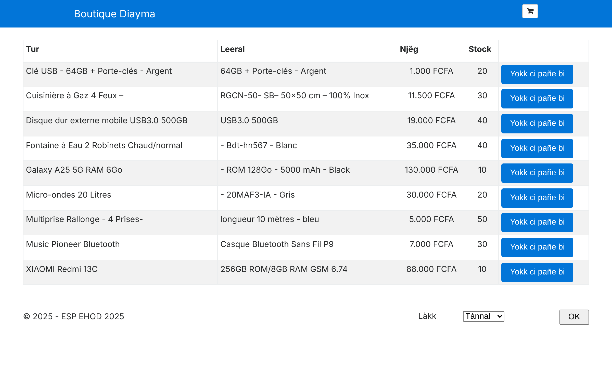

# Boutique Diayma

TD C# et technologies .NET, Visual Studio et débogage.
ESP/UCAD, Département Génie Informatique, année 2026/2027, cours de E. H. Ousmane Diallo.

Réalisé par **Yacine Fall**.

| | |
|---|---|
| Code d'origine | https://github.com/elhadjiousmane/BoutiqueDiayma2025 |
| Exécutable Windows | **[LIEN DRIVE À AJOUTER]** |



## 1. Récupération et exécution

Dans Visual Studio : *Cloner un dépôt*, puis ouvrir `Diayma.sln` et lancer avec **F5**. La fenêtre d'avertissements affichée à l'ouverture se ferme : elle signale que le projet d'origine vise une version de .NET qui n'est plus supportée.

## 2. Projets de la solution

La solution `Diayma.sln` contient **un seul projet**, `Diayma` : une application web ASP.NET Core MVC, type de projet `Microsoft.NET.Sdk.Web`, rangée dans le dossier `P2FixAnAppDotNetCode`. Le dossier et les namespaces gardent l'ancien nom, seul le projet a été renommé.

## 3. Version du SDK .NET

Le projet d'origine déclare `<TargetFramework>netcoreapp2.0</TargetFramework>`, soit **.NET Core 2.0**. Le SDK correspondant est le **SDK 2.1.202**, qui embarque le runtime 2.0.9. Le numéro du SDK ne suit pas celui du runtime. Les paquets utilisés sont `Microsoft.AspNetCore.All` 2.0.6 et `Microsoft.Extensions.Localization` 2.1.1.

## 4. Installation du SDK

.NET Core 2.0 est en fin de vie et Microsoft recommande de passer à une version supportée. J'ai donc migré le projet vers **.NET 10** (LTS, SDK 10.0.401) et c'est ce SDK qu'il faut installer. Le SDK d'origine reste téléchargeable sur https://dotnet.microsoft.com/download/dotnet/2.0 pour exécuter les deux premiers commits.

```
dotnet --version
dotnet run --project P2FixAnAppDotNetCode
```

La migration tient en deux changements : le `TargetFramework` et les paquets dans `Diayma.csproj`, et `EnableEndpointRouting = false` dans `Startup.cs` pour conserver `UseMvc`. Aucun numéro de ligne des points d'arrêt du TD n'a bougé.

## 5. Dépôt GitHub

Ce dépôt conserve l'historique du dépôt d'origine, suivi de mes commits.

## 6. Bugs trouvés

Les deux bugs demandés sont les deux premiers. Les autres ont été découverts pendant les tests.

**Bug 1 : le total du panier ignore les quantités.** Avec 2 XIAOMI à 88 000 et 1 multiprise à 5 000, le sous-total affiche bien 176 000 pour le XIAOMI, mais le total annonce 93 000 au lieu de 181 000. `Cart.GetTotalValue()` additionnait `Product.Price` sans multiplier par `Quantity`. La moyenne avait le même défaut : 46 500 au lieu de 60 333.

**Bug 2 : une commande ne diminue jamais le stock.** Après la commande ci-dessus, le stock du XIAOMI reste à 10 au lieu de 8. `ProductRepository` est enregistré en `Transient` et son constructeur recrée la liste statique `_products` à chaque requête, ce qui efface la mise à jour. Le dépôt est maintenant en `Singleton`.

Autres bugs corrigés :

| Symptôme | Cause | Correction |
|---|---|---|
| On peut commander 11 articles quand le stock est de 10 | `AddToCart` ne vérifie pas le stock | Ajout limité au stock disponible |
| Le formulaire affiche `ErrorMissingName` au lieu du message, et le message de panier vide n'est pas traduit | Depuis le renommage du projet, le localiseur cherche les ressources sous `Resources/P2FixAnAppDotNetCode/...` | Fichiers `.resx` déplacés |
| Prix affichés en €, $, £ ou ¤ selon le navigateur pour des prix en FCFA | `ToString("c")` suit la culture | Méthode `ToFcfa()` |
| Ouvrir `/Order/Completed` à la main vide le panier | `Completed()` en GET appelle `_cart.Clear()` | Appel retiré, `OrderService` vide déjà le panier |
| `FindProductInCartLines` plante sur un produit absent | Accès à `.Product` sur `null` | `?.Product` |

Limites connues, non corrigées :

- **Le panier est partagé entre tous les visiteurs**, car `Cart` est un singleton : un visiteur sans cookie voit le panier d'un autre. Il faudrait stocker le panier en session.
- **L'espagnol ne fonctionne pas** : l'option existe, mais `es` n'est pas une culture supportée et il n'y a aucun fichier `.es.resx`. La page reste en anglais.
- La page du panier n'a pas de titre et le mot `item(s)` n'est pas traduit.

## 7. Points d'arrêt

| | Fichier | Ligne | Code | Quand s'arrête-t-on ? |
|---|---|---|---|---|
| a | `CartSummaryViewComponent` | 12 | `_cart = cart as Cart;` | À chaque page, le composant est dans le layout |
| b | `ProductController` | 15 | `_productService = productService;` | À chaque affichage de l'accueil |
| c | `OrderController` | 17 | `_cart = pCart;` | Sur *Passer la commande* uniquement |
| d | `CartController` | 15 | `_cart = pCart;` | Sur l'ajout au panier ou l'ouverture du panier uniquement |
| e | `Startup` | 20 | `Configuration = configuration;` | Une seule fois, au démarrage |

Pour afficher l'accueil, on s'arrête donc sur **e, b puis a**. Les points c et d ne sont pas atteints.

## 8. Parcours jusqu'à l'affichage des produits

L'ordre ci-dessous a été **relevé par une trace réelle** de l'exécution : une copie temporaire du projet a été instrumentée pour journaliser chaque méthode et sa pile d'appels. La trace vient du code d'origine migré sur .NET 10, sur .NET Core 2.0, le parcours du code applicatif doit rester le même, mais les classes internes du framework et les noms des vues générées diffèrent. Pour le refaire dans Visual Studio, utiliser les modes indiqués et la fenêtre *Pile des appels*.

**Choix du mode**

- **Pas à pas détaillé (F11)** pour entrer dans une méthode de l'application : `GetAllProducts`, puis celle du dépôt.
- **Pas à pas principal (F10)** pour passer une ligne sans y entrer : les lignes de `ConfigureServices`, les 9 `_products.Add`, le `return View(products)`.
- **Pas à pas sortant (Maj+F11)** pour quitter une méthode déjà comprise : `GenerateProductData` après le premier produit, ou le constructeur de `Product`.

**Démarrage, une seule fois**

| # | Namespace | Classe | Méthode | Appelée par |
|---|---|---|---|---|
| 1 | `P2FixAnAppDotNetCode` | `Program` | `Main`, puis `BuildWebHost` | Le runtime |
| 2 | `P2FixAnAppDotNetCode` | `Startup` | constructeur (**point e**) | `ActivatorUtilities.CreateInstance` |
| 3 | `P2FixAnAppDotNetCode` | `Startup` | `ConfigureServices` | `ConventionBasedStartup.ConfigureServices` |
| 4 | `P2FixAnAppDotNetCode` | `Startup` | `Configure` | `ConventionBasedStartup.Configure` |

**Première requête `GET /`**

La route par défaut `{controller=Product}/{action=Index}/{id?}` envoie vers `ProductController.Index`. Le conteneur d'injection construit d'abord les dépendances, en partant des plus profondes.

| # | Namespace | Classe | Méthode |
|---|---|---|---|
| 5 | `P2FixAnAppDotNetCode.Models.Repositories` | `ProductRepository` | constructeur |
| 6 | `P2FixAnAppDotNetCode.Models.Repositories` | `ProductRepository` | `GenerateProductData` |
| 7 à 15 | `P2FixAnAppDotNetCode.Models` | `Product` | constructeur, 9 fois |
| 16 | `P2FixAnAppDotNetCode.Models.Repositories` | `OrderRepository` | constructeur |
| 17 | `P2FixAnAppDotNetCode.Models.Services` | `ProductService` | constructeur |
| 18 | `P2FixAnAppDotNetCode.Controllers` | `ProductController` | constructeur (**point b**) |
| 19 | `P2FixAnAppDotNetCode.Controllers` | `ProductController` | `Index` |
| 20 | `P2FixAnAppDotNetCode.Models.Services` | `ProductService` | `GetAllProducts` |
| 21 | `P2FixAnAppDotNetCode.Models.Repositories` | `ProductRepository` | `GetAllProducts` |
| 22 | `AspNetCoreGeneratedDocument` | `Views__ViewStart` | `ExecuteAsync` |
| 23 | `AspNetCoreGeneratedDocument` | `Views_Product_Index` | `ExecuteAsync` |
| 24 | `AspNetCoreGeneratedDocument` | `Views_Shared__Layout` | `ExecuteAsync` |
| 25 | `P2FixAnAppDotNetCode.Components` | `CartSummaryViewComponent` | constructeur (**point a**) |
| 26 | `P2FixAnAppDotNetCode.Components` | `CartSummaryViewComponent` | `Invoke` |
| 27 | `AspNetCoreGeneratedDocument` | `Views_Shared_Components_CartSummary_Default` | `ExecuteAsync` |
| 28 | `P2FixAnAppDotNetCode.Components` | `LanguageSelectorViewComponent` | `Invoke` |
| 29 | `AspNetCoreGeneratedDocument` | `Views_Shared_Components_LanguageSelector_Default` | `ExecuteAsync` |

`Cart` et `LanguageService` sont aussi créés par le conteneur, mais ils n'ont pas de constructeur explicite. Le premier est construit avant le point a, le second avant le point b.

La vue `Index` du produit s'exécute **avant** le layout : Razor génère d'abord le corps de la page, puis l'insère à l'endroit de `@RenderBody()`.

**Namespaces du framework visibles dans la pile des appels**

| Namespace | Rôle |
|---|---|
| `Microsoft.AspNetCore.Hosting` | Démarrage et appel de `Startup` |
| `Microsoft.Extensions.DependencyInjection` | Création des services |
| `Microsoft.AspNetCore.Mvc.Infrastructure` | Choix et exécution du contrôleur, via `ControllerActionInvoker` |
| `Microsoft.AspNetCore.Mvc.Razor` | Rendu des vues, via `RazorView` |
| `Microsoft.AspNetCore.Mvc.ViewComponents` | Exécution des composants de vue |

Dans la version corrigée, les dépôts sont des singletons : les étapes 5 à 16 n'ont lieu qu'à la première requête.

## 9. Exécutable Windows

Dans Visual Studio : clic droit sur le projet, *Publier*, profil `FolderProfile`. En ligne de commande :

```
dotnet publish P2FixAnAppDotNetCode -c Release -r win-x64 --self-contained
```

L'exécutable est autonome, .NET n'a pas besoin d'être installé. Décompresser le zip, puis double-cliquer sur `Lancer-Diayma.bat`, qui démarre `Diayma.exe` et ouvre http://localhost:5000. Windows peut afficher un avertissement SmartScreen car l'exécutable n'est pas signé : *Informations complémentaires*, puis *Exécuter quand même*.

## 10. Lien vers l'exécutable

**[LIEN DRIVE À AJOUTER]**

## 11. Partie optionnelle

**Wolof.** Les cultures `wo` et `wo-SN` ont été ajoutées dans `Startup.cs`, et celles du français (`fr`, `fr-FR`) sont conservées. Chaque fichier de ressources a son `.wo.resx` et le sélecteur de langue propose l'option Wolof.

**Commits significatifs.** Migration vers .NET 10, correction des bugs, ajout du wolof, documentation et publication.
